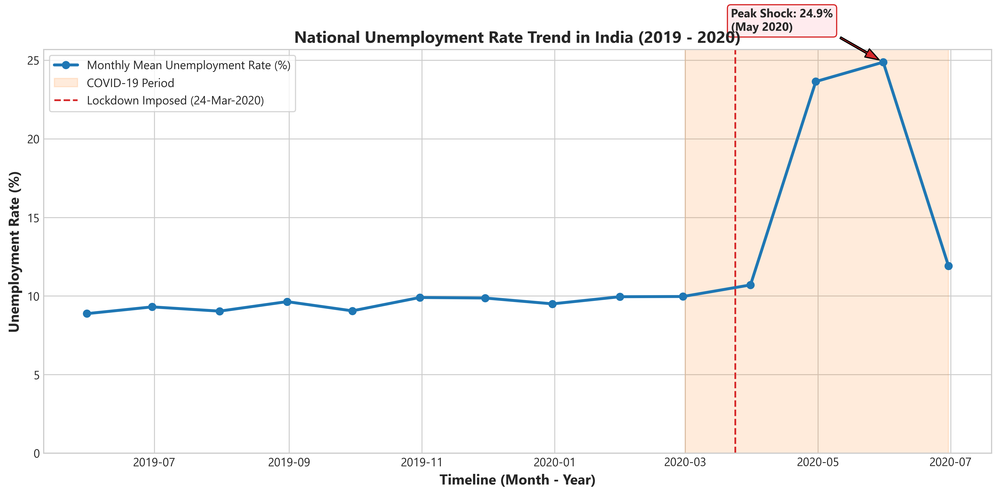
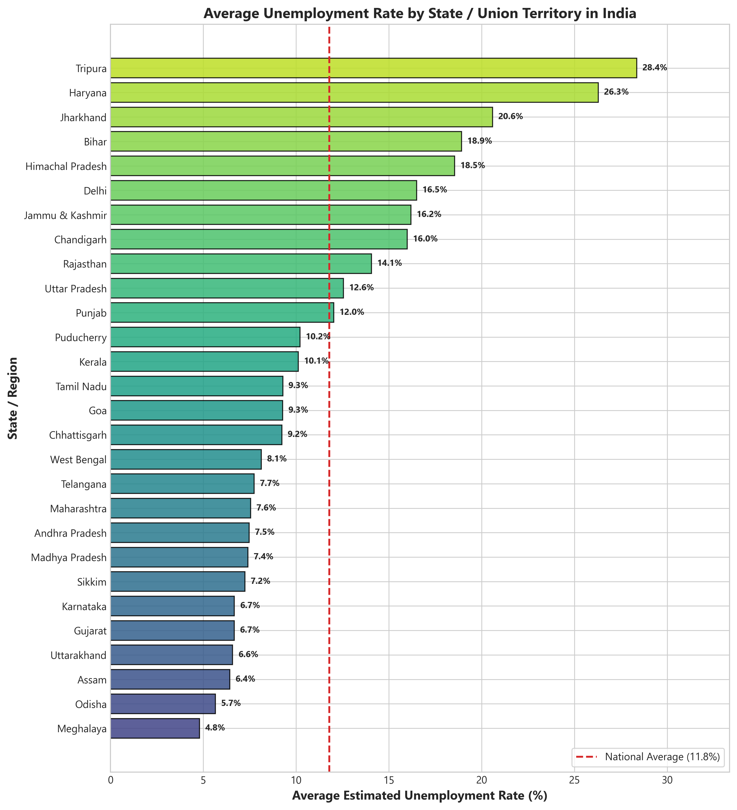
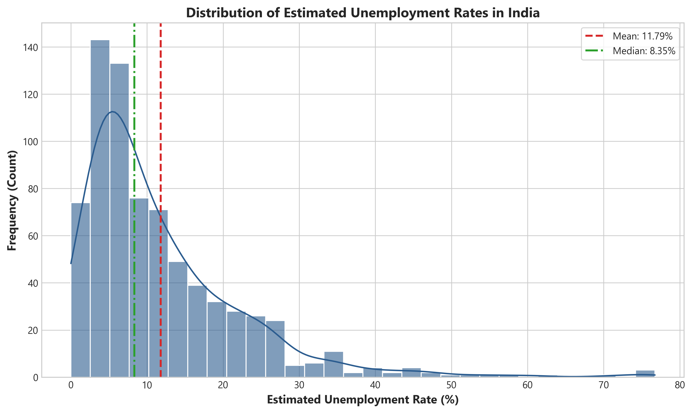
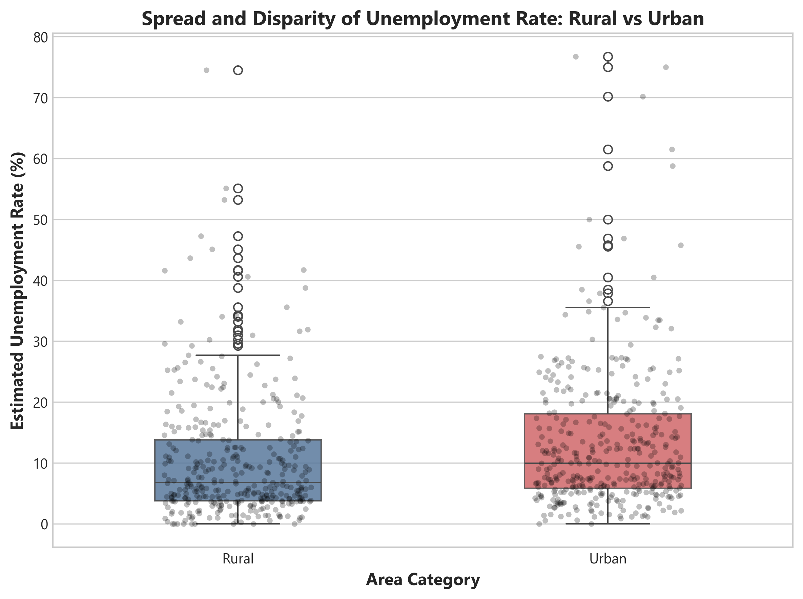
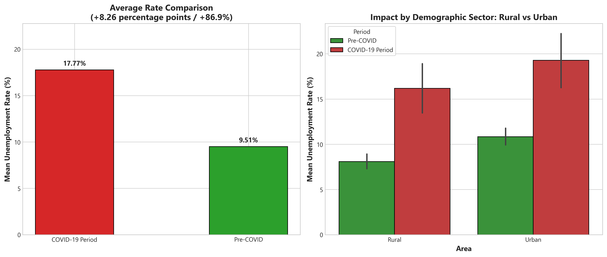
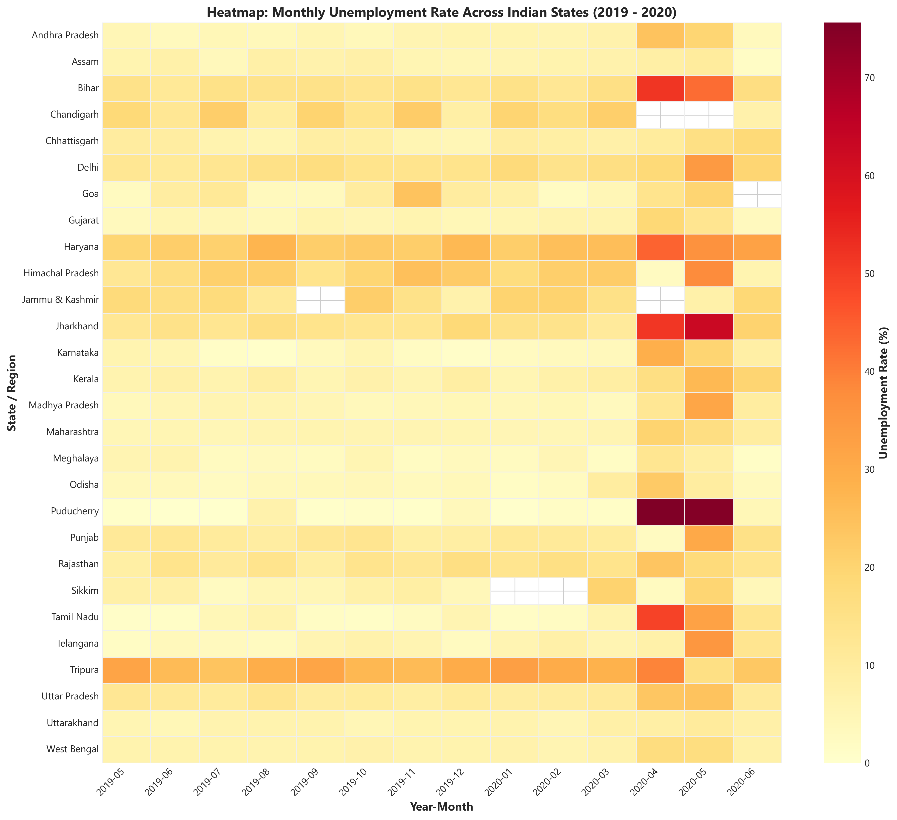

# Unemployment Analysis with Python 🇮🇳

[](https://www.python.org/)
[](LICENSE)
[](https://codealpha.tech/)
[](#)

A comprehensive Data Science and Exploratory Data Analysis (EDA) project analyzing monthly unemployment rates across Indian States and Union Territories between **May 2019 and June 2020**. This project examines pre-pandemic baselines, quantifies the macroeconomic shock during the **COVID-19 national lockdowns**, highlights rural versus urban disparities, and proposes evidence-based socioeconomic policy recommendations.

Completed as part of the **CodeAlpha Data Science Virtual Internship (Task 2)**.

---

## 📌 Table of Contents
- [Project Overview](#-project-overview)
- [Problem Statement & Objectives](#-problem-statement--objectives)
- [Dataset Provenance & Schema](#-dataset-provenance--schema)
- [Tech Stack](#-tech-stack)
- [Project Architecture](#-project-architecture)
- [Installation & Quickstart](#-installation--quickstart)
- [Data Cleaning & Preprocessing Pipeline](#-data-cleaning--preprocessing-pipeline)
- [Visualizations & Key Findings](#-visualizations--key-findings)
- [COVID-19 Pandemic Impact Analysis](#-covid-19-pandemic-impact-analysis)
- [Key Empirical Findings](#-key-empirical-findings)
- [Policy Suggestions & Implications](#-policy-suggestions--implications)
- [Limitations & Future Scope](#-limitations--future-scope)
- [Author & Acknowledgments](#-author--acknowledgments)

---

## 📖 Project Overview

Unemployment is a fundamental barometer of macroeconomic health. The abrupt outbreak of the COVID-19 pandemic in early 2020 and subsequent strict lockdown measures induced severe disruption to India's labor market. 

This repository provides an automated, modular, and beginner-friendly Python data science pipeline that:
1. Automatically cleans and validates survey records.
2. Evaluates time-series trajectories and geographic distributions.
3. Generates publication-ready visualizations saved at 300 DPI.
4. Delivers an interactive Jupyter Notebook walkthrough and statistical reporting.

---

## 🎯 Problem Statement & Objectives

### Problem Statement
How severely did COVID-19 containment measures disrupt employment across India, which geographic areas (Rural vs Urban) absorbed the largest impact, and which states suffered the most critical vulnerabilities?

### Objectives
- **Data Hygiene:** Clean whitespace, resolve blank rows, convert datetimes, and structure temporal cohorts.
- **Trend Discovery:** Trace monthly nationwide labor rate movements.
- **Disparity Mapping:** Compare unemployment rates between Rural and Urban demographics and across 28 States.
- **COVID-19 Impact Quantification:** Compute absolute and relative rate shifts before versus during national lockdown phases.
- **Policy Formulation:** Highlight data-backed implications for social protection programs.

---

## 📂 Dataset Provenance & Schema

- **Primary Source:** High-frequency Indian unemployment survey dataset (`data/unemployment.csv` / `data/Unemployment in India.csv`).
- **Time Coverage:** May 31, 2019 to June 30, 2020 (14 consecutive months).
- **Volume:** 740 cleaned observation records across 28 States and Union Territories.
- **Key Columns:**
  - `Region`: Name of State or Union Territory.
  - `Date`: Survey recording date (monthly frequency).
  - `Frequency`: Recording schedule (`Monthly`).
  - `Estimated_Unemployment_Rate_Pct`: Estimated percentage of unemployed active labor force.
  - `Estimated_Employed`: Estimated count of employed persons.
  - `Estimated_Labour_Participation_Rate_Pct`: Proportion of working-age population active in the labor force.
  - `Area`: Geographic sector (`Rural` or `Urban`).

---

## 🛠 Tech Stack

| Component | Library / Tool | Purpose |
| :--- | :--- | :--- |
| **Language** | Python 3 | Core programming language |
| **Data Manipulation** | Pandas (v2.0+) | Data cleaning, reshaping, aggregation, feature engineering |
| **Numerical Ops** | NumPy (v1.24+) | Matrix and numerical computations |
| **Visualizations** | Matplotlib & Seaborn | Statistical visualization, multi-panel figures, publication styling |
| **Interactive EDA** | Jupyter Notebook | Step-by-step interactive analytical exploration |

---

## 📁 Project Architecture

```
CodeAlpha_Unemployment_Analysis/
│
├── data/
│   ├── unemployment.csv                    # Primary working dataset
│   ├── Unemployment in India.csv           # Original rural/urban survey dataset
│   └── Unemployment_Rate_upto_11_2020.csv  # Regional macro-zone dataset
│
├── notebooks/
│   └── unemployment_analysis.ipynb         # Interactive Jupyter Notebook
│
├── src/
│   ├── __init__.py                         # Package initialization & exports
│   ├── data_loader.py                      # Robust data ingestion module
│   ├── preprocessing.py                    # Data cleaning & feature engineering
│   ├── analysis.py                         # Statistical analysis & findings engine
│   └── visualization.py                    # High-resolution plotting module
│
├── outputs/
│   ├── plots/                              # Saved high-res charts (300 DPI)
│   │   ├── 1_unemployment_trend_over_time.png
│   │   ├── 2_statewise_unemployment_rate.png
│   │   ├── 3_unemployment_rate_distribution.png
│   │   ├── 4_area_wise_boxplot.png
│   │   ├── 5_covid_impact_comparison.png
│   │   └── 6_monthly_unemployment_heatmap.png
│   ├── cleaned_unemployment_data.csv       # Cleaned CSV export
│   └── key_findings.txt                    # Auto-generated analytical findings
│
├── reports/
│   └── unemployment_analysis_report.md     # In-depth scientific markdown report
│
├── main.py                                 # Single-command pipeline executor
├── requirements.txt                        # Python dependencies
├── README.md                               # Project documentation
├── .gitignore                              # Git exclusion rules
└── LICENSE                                 # MIT License
```

---

## 🚀 Installation & Quickstart

### Prerequisites
- Python 3.9 or higher installed on your system.
- Git installed (optional, for version control).

### Step 1: Open Terminal / PowerShell in the Project Directory
```powershell
cd "c:\Users\vaish\OneDrive\Desktop\MY WORKS\CodeAlpha_Unemployment_Analysis"
```

### Step 2: Create and Activate Virtual Environment
**On Windows (PowerShell):**
```powershell
python -m venv venv
.\venv\Scripts\Activate.ps1
```
*(If PowerShell restricts script execution, run: `Set-ExecutionPolicy -Scope Process -ExecutionPolicy Bypass` or execute using `.\venv\Scripts\python.exe main.py`)*

**On macOS / Linux:**
```bash
python3 -m venv venv
source venv/bin/activate
```

### Step 3: Install Dependencies
```bash
pip install -r requirements.txt
```

### Step 4: Run the Complete Pipeline
Execute the main driver script to perform end-to-end data cleaning, statistics, visualization generation, and reporting:
```bash
python main.py
```

### Step 5: Launch Jupyter Notebook (Optional)
```bash
jupyter notebook notebooks/unemployment_analysis.ipynb
```

---

## 🧹 Data Cleaning & Preprocessing Pipeline

The preprocessing stage (`src/preprocessing.py`) handles common real-world survey anomalies:
1. **Column Sanitization:** Eliminates leading and trailing whitespace from raw headers (`' Date'` $\rightarrow$ `'Date'`).
2. **Missing Record Removal:** Drops 28 entirely blank records present at the tail of raw survey CSVs.
3. **Data Type Standardization:** Converts `Date` to `datetime64[ns]` with `dayfirst=True` parsing.
4. **Categorical Stripping:** Removes spurious whitespace in `Region` and `Area`.
5. **Feature Engineering:**
   - `Year` and `Month`: Integer time features.
   - `Month_Name`: Abbreviated month string (`Jan`, `Feb`, etc.).
   - `COVID_Period`: Segmented into `Pre-COVID` (May 2019 – Feb 2020) and `COVID-19 Period` (Mar 2020 – Jun 2020).

---

## 📊 Visualizations & Key Findings

All charts are dynamically generated with actual data and exported to `outputs/plots/`.

### 1. National Unemployment Trend Over Time
Traces monthly national unemployment fluctuations and highlights the acute shock triggered by the March 24, 2020 national lockdown.


### 2. State-Wise Unemployment Rate Comparison
Ranks all Indian States and Union Territories by mean unemployment rate against the national benchmark line.


### 3. Rate Distribution & Spread
Highlights the pronounced right-skewed distribution caused by extreme pandemic lockdown outliers.


### 4. Sector Disparity: Rural vs Urban
Compares unemployment rate distributions between rural and urban centers.


### 5. COVID-19 Period Shift
Measures mean unemployment jumps across overall, rural, and urban segments.


### 6. Monthly Regional Heatmap
Visualizes the synchronized national employment shock across all 28 states during April and May 2020.


---

## 🦠 COVID-19 Pandemic Impact Analysis

To rigorously assess the pandemic shock, the observation timeline is divided into two analytical cohorts:

| Cohort | Pre-COVID (May 2019 – Feb 2020) | COVID-19 Lockdown (Mar 2020 – Jun 2020) | Absolute Shift | Relative Surge |
| :--- | :---: | :---: | :---: | :---: |
| **National Overall** | **9.51%** | **17.77%** | **+8.26% pts** | **+86.91%** |
| **Rural Demographics** | 8.09% | 16.18% | +8.09% pts | +99.90% |
| **Urban Demographics** | 10.84% | 19.28% | +8.43% pts | +77.79% |

> **Analytical Note:** Observed shifts represent statistical associations during the pandemic lockdown window. While containment restrictions were the primary driver, other macroeconomic factors (pre-existing credit slowing, global supply chain bottlenecks) simultaneously affected figures.

---

## 💡 Key Empirical Findings

1. **Overall Average:** The national baseline unemployment rate averaged **11.79%** (median: **8.35%**) over the 740 observations.
2. **Single Observation Extremes:**
   - **Highest single record:** **76.74%** in Puducherry (Urban) in April 2020.
   - **Lowest single record:** **0.00%** in Puducherry in May 2019.
3. **Lockdown Shock Apex:** Monthly national unemployment peaked at **24.88% in May 2020**, up from **8.87% in May 2019**.
4. **COVID Surge:** Average unemployment rose by **+8.26 percentage points (+86.91%)** during the lockdown window.
5. **Urban Vulnerability:** Urban areas experienced higher overall unemployment (**13.17%**) compared to rural areas (**10.32%**).
6. **Highest Unemployment States:** Tripura (**28.35%**), Haryana (**26.28%**), Jharkhand (**20.58%**), Bihar (**18.92%**), Himachal Pradesh (**18.54%**).
7. **Lowest Unemployment States:** Meghalaya (**4.80%**), Odisha (**5.66%**), Assam (**6.43%**), Uttarakhand (**6.58%**), Gujarat (**6.66%**).

---

## 🏛 Policy Suggestions & Implications

- **Urban Social Safety Net:** Institute an urban employment guarantee scheme similar to MGNREGA to protect informal daily-wage earners.
- **Digital Cash Transfers:** Implement automated Direct Benefit Transfer (DBT) mechanisms triggered by macroeconomic shocks.
- **MSME Working Capital Relief:** Provide low-interest credit lines to maintain payrolls during supply-chain disruptions.
- **Regional Skilling Programs:** Focus on states with structurally high baseline unemployment (e.g., Haryana, Jharkhand).

---

## ⚠️ Limitations & Future Scope

- **Time Horizon:** The dataset concludes in June 2020; extending data into 2021–2023 would allow studying the "K-shaped" economic recovery.
- **Informality Data:** The dataset does not differentiate between salaried formal roles and informal casual work.
- **Model Extensions:** Future work could apply ARIMA/SARIMAX time-series forecasting to predict post-lockdown recovery curves.

---

## 👨‍💻 Author & Acknowledgments

- **Intern:** Vaishnav Sreejan (Data Science Intern)
- **Internship:** [CodeAlpha](https://codealpha.tech/) (Task 2: Unemployment Analysis with Python)
- **LinkedIn:** [Your LinkedIn Profile](https://www.linkedin.com/)
- **GitHub:** [@VaishnavSreejan](https://github.com/VaishnavSreejan)

### GitHub Topics
`python` `data-science` `exploratory-data-analysis` `data-visualization` `matplotlib` `seaborn` `pandas` `codealpha` `unemployment-analysis` `covid19-impact`
